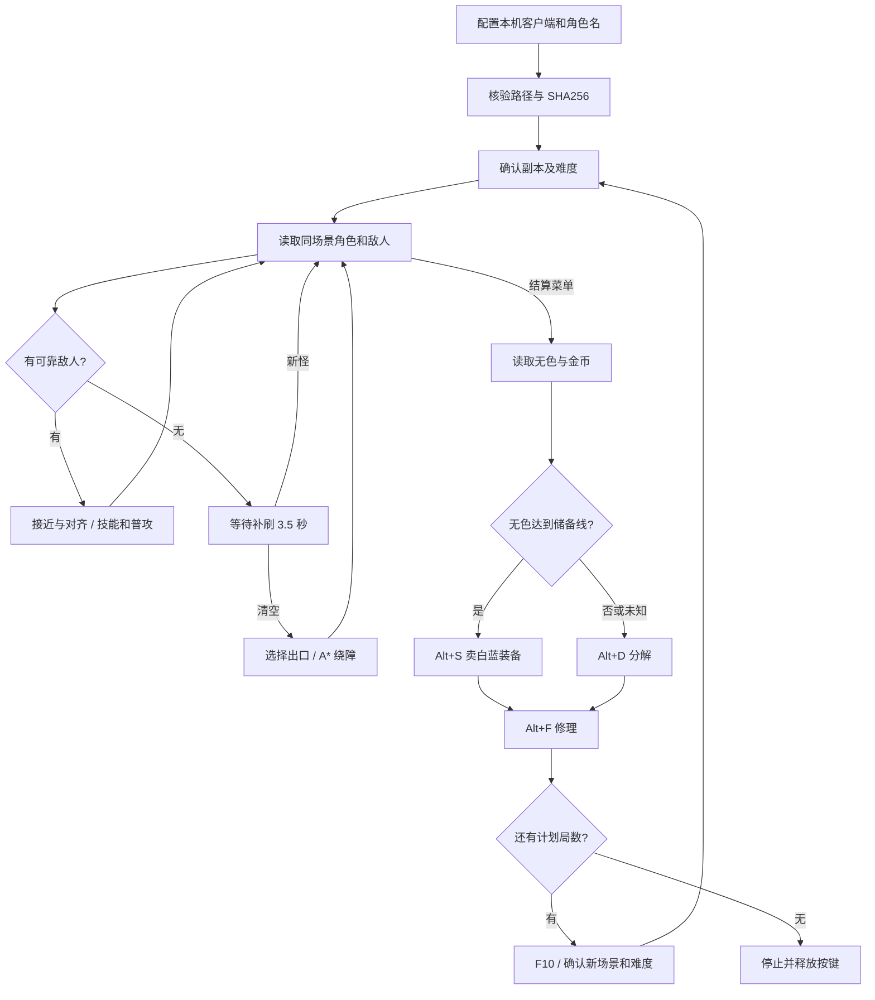

# 刷图脚本解析

## 两条感知通道

战斗依靠客户端中只读的角色、怪物和门坐标。OCR 只负责标题、菜单、维护弹窗和背包数字，血量用生命球的颜色比例估计。这样移动不必等待每一帧 OCR，也减少暗场和人物遮挡造成的停顿。

疲劳不足、未知对象、无法确认地图、复活失败和超时都有停止分支。切出游戏或手动暂停时不继续发送输入。

## 模块与职责

| 文件 | 作用 |
|---|---|
| `configure_farm.py` | 首次设置与客户端哈希核对，生成本机配置 |
| `memory_access.py` | 只读进程接口，不写游戏内存 |
| `coordinate_connection.py` | 核验实际进程路径、文件哈希、模块格式；PID 变化时重连 |
| `dungeon_telemetry.py` | 按模块重定位解析角色、对象列表，校验名字和坐标 |
| `dungeon_farm/combat_telemetry.py` | 单人角色校验、敌我分类、未知对象收集 |
| `dungeon_farm/runtime.py` | 战斗与多局调度，连接感知、决策和输入 |
| `dungeon_farm/planner.py` | 选择目标、对齐攻击线、安排普攻与技能 |
| `dungeon_farm/berserker_rotation.py` | 狂战士快捷栏、估计间隔、双刀和觉醒阶段 |
| `dungeon_farm/navigation.py` | 碰撞学习、A* 路点与停滞处理 |
| `dungeon_farm/door_approach.py` | 门内对齐后跨过门边界 |
| `dungeon_farm/exploration.py`、`route.py` | 出口对象、房间探索、已走出口和回退 |
| `dungeon_farm/waves.py` | 首批清空后等待，发现新怪时撤销过门 |
| `dungeon_farm/background_signals.py` | 后台 OCR，避免阻塞方向键控制 |
| `dungeon_farm/screen_signals.py` | 标题、难度、结算、维护提示、背包数字与 HUD |
| `dungeon_farm/inventory.py` | 核对无色物品名和多次一致的数量、金币读数 |
| `dungeon_farm/cycle.py`、`cycle_inputs.py` | 结算状态机、Alt 组合键、F10 与重进核对 |
| `dungeon_farm/resources.py`、`revival.py` | 低血量补给与有界复活重试 |
| `dungeon_farm/gui.py` | 启停、难度和局数、状态显示与全局热键 |

## 为什么重启后仍可连接

不把上一进程的堆地址作为下次启动的角色位置。连接时核对客户端版本，获取模块基址，应用经过验证的相对布局，再重新检查当前角色与场景对象。游戏更新、角色类型不匹配或地址失效时返回无效数据，释放输入并等待或停止。

单人数据还核对本机角色名、角色是否属于当前场景、镜像坐标是否一致，以及读取前后场景是否变化。怪物类型与部分 APC 名字共同决定敌我，友军按已经观测的类型与名字排除。无法分类的对象不会被直接当成“房间已清空”。

## 房内绕障和房间探索是两件事

房内把坐标按 20 像素转成网格。实际到达的格子代价为 1，未知格代价为 3，碰撞格不可走；因此优先使用走过的地面。A* 来自 `pathfinding==1.0.23`，禁止穿过障碍拐角。

连续约 0.5 秒不能缩短与路点的距离时记录前方碰撞，并加一格推测边缘。无路时先移除推测边缘，保留实际碰撞记录，再尝试邻近可达目标；连续停滞重规划仍失败则暂停。移动容差随实际步幅调整，直线路点合并，长横向移动使用跑步。施法或暂停不计为移动卡住。

房间级逻辑记录入口和已走出口，优先未探索方向，死路返回。门口先在室内对齐，再向外跨越。它并不知道整张随机地图的最短路径，因此不能保证访问房间数最少。

## 攻击和二轮怪

目标在攻击范围内时优先修正纵向站位，不为了固定距离反复后退。技能调度用预设间隔和动作持续时间估计，普攻填充空档；没有读真实冷却。H 是开关技能，不能每次循环乱按；Y 有准备与后续释放阶段。

第一次没有敌人不立即过门。`WaveTracker` 保留 3.5 秒观察窗，且走向出口期间仍读取怪物；新怪出现就取消出口决策并回到战斗。

## 维护和收益

结算时先打开材料栏，核对物品名，再用多个数字裁剪和连续观测读取库存，避免把其他材料或带小数点的 OCR 错误当成无色。储备线为 `max(100, round_cube_upper * 2 + 30)`；`round_cube_upper` 是按成功发送的技能输入累计的保守估计，并非实际消耗。

无色够用选择 Alt+S，否则选择 Alt+D；然后 Alt+F。组合键顺序是 Alt 按下、短暂等待、字母按下、字母松开、Alt 松开。检测到成功弹窗时先确认，再推进。没有弹窗时不能仅凭发送日志断言游戏已执行，卖装历史问题见 README。

需要下一局时发送一次 F10，再核对新场景、门对象、目标副本和难度。最后一局仍维护但不重进。游戏明确提示疲劳不足时停止，没有推算并伪装精确的剩余疲劳值。

金币统计用相邻有效快照的差额。缺失起点读数时写 `null`，不中途补造基线。材料估价、未出售装备价值、药品及无色的市价都未纳入，因此它是现金变化记录，不是完整利润报表。

## 来源与发布边界

A* 直接依赖 [python-pathfinding](https://github.com/brean/python-pathfinding)（MIT），通过 pip 安装时保留上游许可证。其他 DNF 项目用于区分房间级方向选择与房内寻路，说明见 [navigation-sources.md](dungeon_farm/navigation-sources.md)；发布包没有复制第三方注入程序或游戏客户端代码。

源码中保留已验证客户端的结构偏移和对象类型，属于该版本适配逻辑；不附带任何进程快照、实际堆内存、登录文件或运行截图。配置、日志和故障详情由使用者在本机生成。
