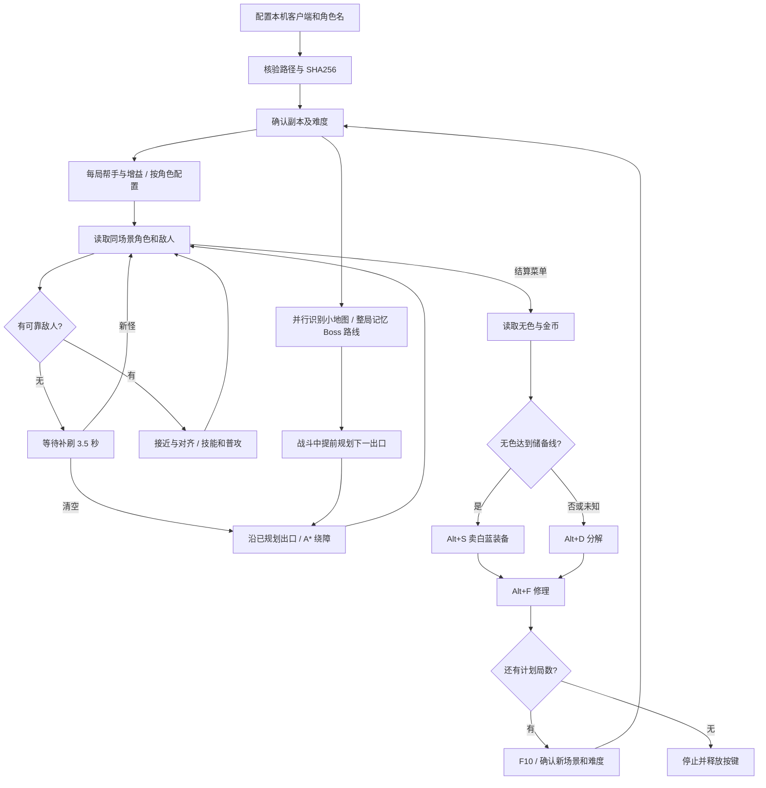

# 刷图脚本解析

## 设计思路与三类感知信息

先建立整局到 Boss 的路线，再用实时目标决定移动和攻击；清空房间后沿已确定的出口继续。攻击优先用短冷却技能，空档普攻，每次发出攻击前再次核对目标，减少空放与消耗。

战斗依靠客户端中只读的角色、怪物和门坐标；小地图独立采样，保存整局房间图和 Boss 位置；OCR 负责标题、菜单、维护弹窗和背包数字，血量用生命球的颜色比例估计。移动和战斗不必等待每一帧 OCR，也减少暗场和人物遮挡造成的停顿。

疲劳不足、无法确认地图、复活失败和超时都有停止分支。单人清怪按当前设置记录并忽略未适配对象；忽略不能代替击杀可能堵门的敌人。切出游戏或手动暂停时不继续发送输入。启动时在维护操作之前核对实际角色名和类型，避免换角色后沿用旧方案。

## 模块与职责

通用入口见 `dungeon_farm/generic.py`：只观察手动入场，不发送选图指令；普通怪物按已知对象类别识别，已知友军排除。小地图使用动态网格和逐步补充的连线，雾区路线不完整时转为真实出口探索与回退。通用模式不借用阿登高地的固定房间图。

| 文件 | 作用 |
|---|---|
| `configure_farm.py` | 首次设置与客户端哈希核对，生成本机配置 |
| `memory_access.py` | 只读进程接口，不写游戏内存 |
| `coordinate_connection.py` | 核验实际进程路径、文件哈希、模块格式；PID 变化时重连 |
| `dungeon_telemetry.py` | 按模块重定位解析角色、对象列表，校验名字和坐标 |
| `dungeon_farm/combat_telemetry.py` | 单人角色校验、敌我分类、未知对象收集 |
| `dungeon_farm/runtime.py` | 战斗与多局调度，连接感知、决策和输入 |
| `dungeon_farm/planner.py` | 选择目标、对齐攻击线、安排普攻与技能 |
| `dungeon_farm/berserker_rotation.py` | 狂战士快捷栏、估计间隔、双刀和觉醒阶段 |
| `dungeon_farm/blade_rotation.py` | 刃影面板 CD、短 CD 优先、每局帮手与追踪术 |
| `dungeon_farm/wind_rotation.py` | 风神技能面板 CD、流风诀、短 CD 优先和人偶 |
| `dungeon_farm/mechanic_rotation.py` | G 系列续时和补按、远程退避、普通房节奏、Boss Y 后立即 C |
| `dungeon_farm/navigation.py` | 碰撞学习、A* 路点与停滞处理 |
| `dungeon_farm/door_approach.py` | 门内对齐后跨过门边界 |
| `dungeon_farm/exploration.py`、`route.py` | 出口对象、房间探索、已走出口和回退 |
| `dungeon_farm/minimap.py` | 阿登高地小地图当前位置、Boss、连接线及房间图最短路径 |
| `dungeon_farm/waves.py` | 首批清空后等待，发现新怪时撤销过门 |
| `dungeon_farm/background_signals.py` | 后台 OCR，避免阻塞方向键控制 |
| `dungeon_farm/screen_signals.py` | 标题、难度、结算、维护提示、背包数字与 HUD |
| `dungeon_farm/inventory.py` | 核对无色物品名和多次一致的数量、金币读数 |
| `dungeon_farm/cycle.py`、`cycle_inputs.py` | 结算状态机、Alt 组合键、F10 与重进核对 |
| `dungeon_farm/resources.py`、`revival.py` | 低血量补给与有界复活重试 |
| `dungeon_farm/gui.py` | 启停、难度和局数、每角色血药键与人偶设置、状态显示与全局热键 |
| `dungeon_farm/characters.py` | 本机角色发现、按角色保存技能及血药配置 |
| `dungeon_farm/team.py` | 同场景队友坐标、门口等人、小号纯跟随决策 |
| `dungeon_farm/team_link.py`、`team_ui.py` | 局域网配对、心跳、会话与轮次就绪确认 |

双机模式各自读取本机客户端坐标，局域网仅同步阶段和轮次，不交换场景地址，不发送远程按键命令。小号跟随分支不进入战斗技能调度，也不卖装或修理；小号报告当前会话/轮次就绪后仅大号发送 F10。连接失效或成员未就绪时等待，超时停止。

## 为什么重启后仍可连接

不把上一进程的堆地址作为下次启动的角色位置。连接时核对客户端版本，获取模块基址，应用经过验证的相对布局，再重新检查当前角色与场景对象。游戏更新、角色类型不匹配或地址失效时返回无效数据，释放输入并等待或停止。

单人数据还核对本机角色名、角色是否属于当前场景、镜像坐标是否一致，以及读取前后场景是否变化。怪物类型与部分 APC 名字共同决定敌我，友军按已经观测的类型与名字排除。无法分类的对象不会被直接当成“房间已清空”。

## 房内绕障和房间探索是两件事

房内把坐标按 20 像素转成网格。实际到达的格子代价为 1，未知格代价为 3，碰撞格不可走；因此优先使用走过的地面。A* 来自 `pathfinding==1.0.23`，禁止穿过障碍拐角。

连续约 0.5 秒不能缩短与路点的距离时记录前方碰撞，并加一格推测边缘。无路时先移除推测边缘，保留实际碰撞记录，再尝试邻近可达目标；连续停滞重规划仍失败则暂停。移动容差随实际步幅调整，直线路点合并，长横向移动使用跑步。施法或暂停不计为移动卡住。

门内对齐且距门不超过 110 时，直接向门触发点推进；这段不把门外不可行走边界交给 A* 当作障碍绕行。触发不成功时沿用短时间停滞后调整门道位置的处理。未对齐或距离较远时仍使用正常寻路。

阿登高地读取右上角小地图的当前位置、红色 Boss 标记和房间连接线，建立房间图并用 BFS 选择最短路线。需要两次独立画面确认，并与本房间实际门对象交叉核对；已确认不存在的连接在本轮中保持禁用。已有可靠地图时，短暂漏检沿用缓存；尚无可靠路线时等待，不退回固定向右试路。当前校准针对本客户端阿登高地的 4×5 小地图网格，其他地图仍使用已配置探索器，不能直接套用。

新一局迷雾遮挡未探索的连线时，使用此前通关验证的阿登连接图补全，仍要求看清当前位置与 Boss，且每间实际出口均有否决权。小地图由独立轻量线程约每 0.15 秒采样，不等待整屏 OCR；双帧确认与 3.5 秒补怪观察并行。清空后若累计 10 秒仍无法确认路线则暂停并显示原因，不无限等待或盲走。该上限不包含战斗、实际移动、结算或用户暂停的时间。

路线在进图后的战斗阶段就建立，并在整局保留地图、Boss 位置、场景对应的房间格及禁用连接。按实际过门方向推进所在房间，后台画面负责核对和纠偏；短暂漏检不清空路线，也不要求清场后重新看图。战斗中的临时关门不记为永久断路，清场时才核对实际出口。新一局重新建立记忆，避免沿用上一局的场景地址。

门口先在室内对齐，再向外跨越。若清场站在其他入口外侧，先避开该入口的触发区域，防止走向下一门时误退回上一房。到目标未过图则继续小幅推进；原地停滞时在目标门旁有限范围重新对齐。发生意外换房时，根据实际接近的门修正记录，而不是把计划中的门直接当作已通过。

入口避让使用连续路点，完成向室内撤离后才切换到目标门，避免每帧重算在边界处来回摆动。阿登高地实测从小地图 `(1,1)` 经 `(2,1) → (2,2) → (2,3) → (1,3) → (1,4) → (2,4)` 到达 `(3,4)` Boss 房，连续七次换房没有回退；前面的房间已清空，这段结果不代表完整一局的刷图耗时。

## 攻击和二轮怪

目标在攻击范围内时优先修正纵向站位。技能调度用预设间隔和动作持续时间估计，普攻填充空档；没有读真实冷却。狂战士方案单独处理 H 开关和 Y 觉醒阶段；通用方案轮换所有技能栏，不能保证所有职业机制均适合。

“刃影冷却优先”使用已从客户端面板核对的技能 CD，进图先施放一次追踪术，复活后重开。攻击按短 CD、低 MP 排序，冷却期间补 X；发送攻击前重新核对目标存活与范围，清空后取消未执行动作。冷却时间在同一连续运行中跨房、跨局保存。详细数值及计时局限见 `dungeon_farm/刃影技能说明.md`。

角色启用 `entry_helper` 后，每局在追踪术前按一次 4。调度器记录本局已执行状态，换房、暂停恢复、复活都不重复召唤；下一局重置。已确认的“偉大的杜爾夫”按类型和名字识别为友军；中途重启助手时若读到它，也将本局召唤标记为已执行。按键发送成功不等于道具一定生效，因此不会因为暂时看不到帮手反复按 4。

第一次没有敌人不立即过门。`WaveTracker` 保留 3.5 秒观察窗，且走向出口期间仍读取怪物；新怪出现就取消出口决策并回到战斗。

## 维护和收益

结算时先打开材料栏，核对物品名，再用多个数字裁剪和连续观测读取库存，避免把其他材料或带小数点的 OCR 错误当成无色。储备线为 `max(150, max(0, 入场库存 - 结算维护前库存) * 2 + 30)`；没有有效基线就使用 150。库存下降是净消耗，可能受掉落抵消，并非逐次技能的精确成本。技能输入估计只留作日志参考，不再用于决定分解，避免库存上千仍反复分解。

无色够用选择 Alt+S，否则选择 Alt+D；然后 Alt+F。组合键顺序是 Alt 按下、短暂等待、字母按下、字母松开、Alt 松开。检测到成功弹窗时先确认，再推进。没有弹窗时不能仅凭发送日志断言游戏已执行，卖装历史问题见 README。

需要下一局时发送一次 F10，再核对新场景、门对象、目标副本和难度。最后一局仍维护但不重进。游戏明确提示疲劳不足时停止，没有推算并伪装精确的剩余疲劳值。

金币统计用相邻有效快照的差额。缺失起点读数时写 `null`，不中途补造基线。材料估价、未出售装备价值、药品及无色的市价都未纳入，因此它是现金变化记录，不是完整利润报表。

## 来源与发布边界

A* 直接依赖 [python-pathfinding](https://github.com/brean/python-pathfinding)（MIT），通过 pip 安装时保留上游许可证。其他 DNF 项目用于区分房间级方向选择与房内寻路，说明见 [navigation-sources.md](dungeon_farm/navigation-sources.md)；发布包没有复制第三方注入程序或游戏客户端代码。

源码中保留已验证客户端的结构偏移和对象类型，属于该版本适配逻辑；不附带任何进程快照、实际堆内存、登录文件或运行截图。配置、日志和故障详情由使用者在本机生成。
